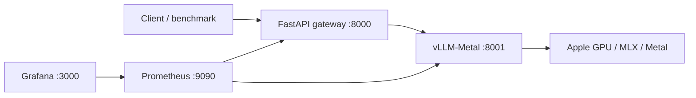

# LLM Inference Platform

[](https://github.com/sunilmehta-si/llm-inference-platform/actions/workflows/ci.yaml)

**GPU-backed LLM serving on Apple Silicon, with an observable API gateway and reproducible benchmarks.**

Built by [Sunil Mehta](https://github.com/sunilmehta-si), Lead DevOps, MLOps & Platform Engineer.

[](https://github.com/sunilmehta-si/llm-inference-platform/actions/workflows/ci.yaml)

**[Full local walkthrough](docs/local-walkthrough.md)** · **[Measured GPU results](benchmarks/README.md)**

This project explores the operational side of LLM inference: streaming, admission control,
timeouts, model readiness, performance measurement, and deployment. Model computation runs
natively on the Mac GPU through vLLM-Metal. A separate Python gateway provides a portable
API boundary; Prometheus and Grafana expose what happens under load.

## Architecture



| Component | Responsibility |
|---|---|
| Gateway | Bearer authentication, model allowlist, body/output limits, rate limiting, bounded concurrency, streaming proxy, timeouts |
| Browser chat | Streaming conversation, model readiness, token/temperature controls, stop generation, per-request timing |
| Engine | Model loading, tokenization, inference, batching, KV cache; engine-owned scheduling |
| Benchmark | First-content latency, completion latency, reported token throughput, errors, hardware/config metadata |
| Monitoring | Request outcomes, inflight requests, latency histograms, reported output tokens |
| Helm | Portable gateway and an optional NVIDIA Linux deployment blueprint |

## Quick start on Apple Silicon

Requirements: Apple Silicon Mac, macOS 15+, Python 3.13, Homebrew, and enough disk space for
the engine and model. The default 7B 4-bit checkpoint is several GB. Unified memory is shared
with macOS; context length and concurrency increase inference memory requirements.

```bash
git clone https://github.com/sunilmehta-si/llm-inference-platform.git
cd llm-inference-platform
make setup
make key

# Homebrew needs the explicit tap URL; automatic tap discovery uses a different repo name.
brew tap vllm-project/vllm-metal https://github.com/vllm-project/vllm-metal
brew install vllm-project/vllm-metal/vllm-metal
make engine
```

In a second terminal:

```bash
cd llm-inference-platform
make gateway
```

In a third terminal, load the locally generated configuration:

```bash
cd llm-inference-platform
set -a
source .env
set +a
.venv/bin/python scripts/smoke.py
```

The engine binds to `127.0.0.1:8001`; the gateway binds to `127.0.0.1:8000`.
Swagger documentation is at <http://127.0.0.1:8000/docs>.
The **chat frontend** is at <http://127.0.0.1:8000/>. Paste your private `.env` API key into the
left panel, type a question in the bottom message box, and click **Send message**. The key stays
in page memory and is not saved to browser storage. Answers render as text, not executable HTML.
`make key` generates a private `.env`, refuses to overwrite an existing file, and never prints
its credential. Model weights are downloaded from Hugging Face into the engine's local cache.

## Try streaming

With `.env` loaded in your terminal:

```bash
curl -N http://127.0.0.1:8000/v1/chat/completions \
  -H "Authorization: Bearer $GATEWAY_API_KEY" \
  -H 'Content-Type: application/json' \
  -d '{"model":"mlx-community/Qwen2.5-7B-Instruct-4bit","messages":[{"role":"user","content":"Explain KV caching in three sentences."}],"max_tokens":128,"stream":true}'
```

The supported API surface is intentionally small: text messages, temperature, output limit,
JSON or streaming responses. It does not claim full OpenAI API compatibility; tools, images,
and arbitrary model switching are rejected. The engine API remains reachable only on loopback.

## Measure inference

```bash
# Record the checkpoint revision from the local Hugging Face cache.
export MODEL_REVISION="$(cat "$HOME/.cache/huggingface/hub/models--mlx-community--Qwen2.5-7B-Instruct-4bit/refs/main")"
# Use the actual engine version reported by your installation.
.venv/bin/python -m scripts.benchmark \
  --backend 'vllm-metal 0.30.0' \
  --requests 12 --concurrency 1 --max-tokens 128 \
  --output benchmarks/mac-concurrency-1.json

.venv/bin/python -m scripts.benchmark \
  --backend 'vllm-metal 0.30.0' \
  --requests 12 --concurrency 4 --max-tokens 128 \
  --output benchmarks/mac-concurrency-4.json
```

Warmup requests are excluded. Token counts come from backend usage fields; missing usage is
recorded as unavailable, never estimated from chunks or words. TTFT means the first non-empty
content/reasoning delta observed by the client. End-to-end throughput includes prompt processing
and queueing; it is not isolated decode throughput. Any failed measured request makes the command
exit unsuccessfully while preserving the report.

See [benchmark evidence](benchmarks/README.md) and [measurement methodology](docs/benchmarking.md).
To reproduce a recorded checkpoint, set `MODEL_REVISION` before `make engine`; the startup script
passes it to the engine. An omitted revision follows the model repository's current default branch.

## Monitoring

With Docker Desktop running:

```bash
make observability
```

- Prometheus: <http://127.0.0.1:9090>
- Grafana: <http://127.0.0.1:3000>, provisioned read-only dashboard
- Raw gateway metrics: <http://127.0.0.1:8000/metrics>

The local stack contains no NVIDIA DCGM metrics. Gateway latency and token throughput are
application measurements, not GPU utilization. Host memory metadata is not a measured GPU
memory trace. See [runbooks](docs/runbooks.md) for connectivity and failure diagnosis.

## Validation

```bash
make check       # Python lint/format/tests and both Helm profiles
docker build -t llm-inference-platform:local .
```

Tests exercise authentication, malformed upstream responses, fragmented SSE, streaming failure,
timeout/cancellation cleanup, concurrent admission, rate limits, request limits, and model
readiness using a deterministic backend. They require no model or GPU. GPU validation is a
separate smoke/benchmark run, recorded in `benchmarks/`.

`requirements-tested.txt` pins the validated gateway/test dependency versions. The native model
runtime is installed separately by Homebrew; its version belongs in every benchmark report.

GitHub Actions runs these checks and builds the gateway image. Image publishing is manual:

```bash
docker build -t ghcr.io/sunilmehta-si/llm-inference-platform:0.1.0 .
docker push ghcr.io/sunilmehta-si/llm-inference-platform:0.1.0
```

## Kubernetes and NVIDIA deployment

See [deployment instructions](docs/deployment.md). The NVIDIA profile requests one GPU and
uses a model cache PVC and shared-memory volume. This profile needs a Linux GPU cluster with
drivers/device-plugin support and sufficient VRAM; it does not turn local Docker/Kubernetes
into an Apple GPU inference runtime.

The gateway image must be built and made available before deploying. Helm rendering is
validated locally; NVIDIA execution must be validated on actual NVIDIA hardware before claiming
CUDA performance or production readiness.

## Engineering decisions

- Keep model execution native on macOS; supporting services can run in containers.
- Bound active inference requests and reject excess load with `429` instead of creating an
  unbounded gateway queue. The engine handles scheduling within the admitted workload.
- Use a single gateway worker/replica for this demo. Admission/rate state is process-local;
  multi-replica operation needs shared enforcement or deliberately partitioned limits.
- Never log prompts, generated content, or API keys in gateway logs or benchmark reports.
- After streaming headers are sent, backend failures are represented by an SSE error and
  `[DONE]`; the original HTTP status cannot then change. Monitor stream outcomes, not only HTTP 200.
- Treat benchmark results as measurements of a documented workload, not production SLAs.

## Observed on the Mac

The initial Qwen2.5 7B 4-bit run on an M5 Pro / 48 GiB Mac completed **24/24 measured requests**.
Aggregate output throughput was **40.29 tokens/s at concurrency 1** and **60.07 tokens/s at
concurrency 4**. Higher concurrency also increased first-token and completion latency; see the
[raw reports and comparison](benchmarks/README.md) before interpreting the throughput improvement.

Further discussion: [architecture and tradeoffs](docs/architecture.md).

## Project layout

```text
gateway/                 API, configuration, SSE inspection
scripts/                 startup, smoke test, streaming benchmark
tests/                   deterministic operational regression tests
deploy/compose.yaml      local monitoring
deploy/helm/inference/   Kubernetes deployment profiles
docs/                    architecture, runbooks, deployment, measurement
benchmarks/              reproducible measured evidence
.github/workflows/       automated validation and container build
```

## References

- [vLLM-Metal](https://github.com/vllm-project/vllm-metal)
- [Supported Metal model families](https://github.com/vllm-project/vllm-metal/blob/main/docs/supported_models.md)
- [MLX-LM](https://github.com/ml-explore/mlx-lm)
- [vLLM production metrics](https://docs.vllm.ai/en/latest/usage/metrics/)

Code is MIT licensed. Model weights and third-party components retain their own licenses.

## Related projects

Other open-source infrastructure work by [Sunil Mehta](https://github.com/sunilmehta-si):

- [agentic-code-review-tool](https://github.com/sunilmehta-si/agentic-code-review-tool): Scanner-grounded AI code review for the whole pull request: app, infrastructure and AI/agent code.
- [k8s-gpu-scheduler-benchmark](https://github.com/sunilmehta-si/k8s-gpu-scheduler-benchmark): Benchmarks Kubernetes GPU schedulers (default, Kueue, Volcano, KAI) in simulation and on real clusters.
- [ai-devsecops-cicd](https://github.com/sunilmehta-si/ai-devsecops-cicd): Reference DevSecOps pipeline for LLM and AI-agent services: AI security tests, SBOM/AI-BOM, signing, admission policy.
- [jev-inference-router](https://github.com/sunilmehta-si/jev-inference-router): Observable decision routing for local GPU inference, evaluated against rule-based and classifier baselines.
