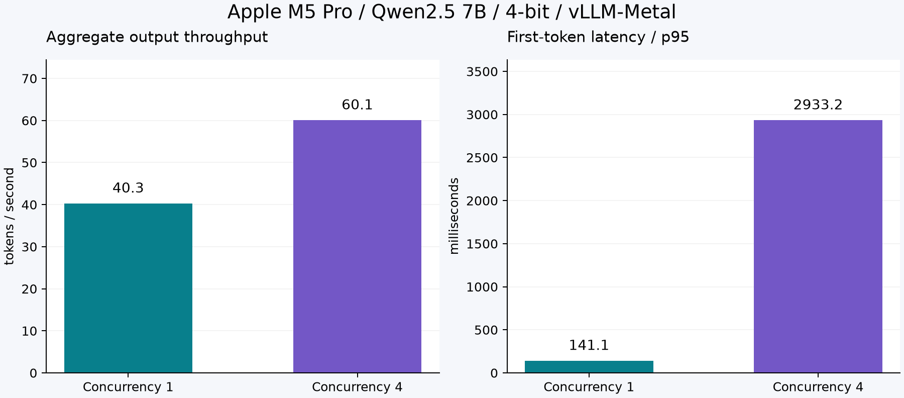

# Measured GPU inference on Apple M5 Pro

Recorded on 6 October 2026 with **48 GiB unified memory** and macOS 27.0.1.
Engine: `vllm-metal 0.30.0 / vLLM 0.30.0`. Model: `mlx-community/Qwen2.5-7B-Instruct-4bit`.
Checkpoint revision: `c26a38f6a37d0a51b4e9a1eb3026530fa35d9fed`.



| Concurrency | Successful requests | Aggregate tokens/s | TTFT p50 (ms) | TTFT p95 (ms) | Completion p95 (s) |
|---|---|---|---|---|---|
| 1 | 12/12 | 40.29 | 91.5 | 141.1 | 3.28 |
| 4 | 12/12 | 60.07 | 273.2 | 2933.2 | 9.70 |

Both runs use 12 measured requests, two warmup requests, the same four short prompts,
temperature zero, and an output limit of 128 tokens. All 24 measured requests completed.
Engine settings: context 4096, maximum four sequences, chunked prefill 2048, prefix caching
enabled, and the observed default GPU memory utilization setting of 0.92.

**Interpretation:** four concurrent requests increase aggregate throughput, while individual
requests take longer and first-token tail latency rises. This is a throughput/latency tradeoff,
not an across-the-board performance improvement. The small sample and repeated prompts do not
establish production capacity, an SLA, or cold-start behavior.

GPU execution was confirmed by engine startup: MLX `Device(gpu, 0)`, PyTorch `mps`, native
paged-attention Metal kernels, and M5 NAX prefill attention kernels. A `+cpu` package suffix or
CPU-named bookkeeping field in vLLM does not identify this plugin's actual compute backend.

Raw observations: [concurrency 1](mac-concurrency-1.json), [concurrency 4](mac-concurrency-4.json).
See [measurement methodology](../docs/benchmarking.md) for metric definitions and limitations.

Recreate the chart after installing the optional reporting dependency:

```bash
.venv/bin/python -m pip install -e '.[report]'
make report
```
